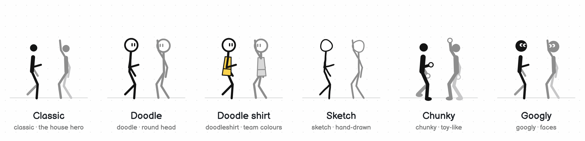

# goofyfish style guide

Every game looks like a quick ink drawing on dotted paper. Keep the world mostly black, white and grey, and save colour for the one thing that matters.

## Palette

| Token | Value | Use |
|---|---|---|
| paper | `#ffffff` | page and canvas background |
| dot | `rgba(31,41,55,.13)` | 24px dot grid behind everything (CSS background, not canvas) |
| ink | `#141414` (canvas) / `#1f2329` (UI) | figures, outlines, ground |
| far limb | `#9a9a9a` | the stick figure's back arm and back leg |
| muted | `#737373` / `#7a7a7a` | labels, secondary text |
| faint | `#d4d4d4` | guides, inactive things |
| butter | `#fde68a`, `#fcd34d` | the hero accent: primary button, chips, highlighted objects |
| butter-soft | `#fef3c7` | soft highlight panels |
| amber | `#b45309` | score popups, "perfect" moments, a headband |
| umber | `#78350f` | text on butter |

Use one accent per moment. If everything is yellow, nothing is.

## Stick figures

### Figure styles

Every game picks one body style. Ask the person which one they want when you pitch (Classic if they don't mind), then set `FIG_STYLE` at the top of the stick figure code. Poses, props, `J` anchors and `pnpm game:motion` work the same in every style.

| `FIG_STYLE` | Looks like | Good for |
|---|---|---|
| `classic` | Solid head, thick torso, grey far limbs | The house hero; one figure doing one thing |
| `doodle` | Big hollow round head with two line eyes, thin even body | Friendly characters, hats and hoods read well on the big head |
| `doodleshirt` | Doodle in a shirt (`opts.shirt`) | Teams and crowds: shirt colour tells sides apart (Skirmish) |
| `sketch` | Hollow wobbly head, thin pen lines that redraw a few times a second | A hand-drawn flipbook feel |
| `chunky` | Thicker limbs, round mitten hands, little boots | Toy-soldier feel; hands make held props obvious |
| `googly` | Bigger solid head with googly eyes | The silliest; kids read facing instantly |

You can also set `opts.style` on a single `drawFigure` call, for example one googly boss among classic figures.

### Classic proportions

- Head: a **solid black circle**, radius about 7.8 at the game's base scale. Never draw a face on the classic hero (the other styles bring their own faces).
- Torso: stroke width 8.5. Legs: 5. Arms: 4.2. Round caps and round joins.
- Front limbs in ink, back limbs in `#9a9a9a` (this gives depth without shading).
- Proportions at base scale: thigh and shin about 30 each, upper arm and forearm about 21 each, head centre about 20 above the chest.
- Pose with keyframes and blend between them: use `P`, `mk()`, `Actor` and `drawFigure()` from `snippets.js` rather than drawing your own. Small idle breathing and a crouch on landing make it feel alive.
- Enemies ("goons") are round blobs with googly eyes, or grey stick figures.

### Anatomy

- Elbows and knees only bend the way real ones do: a forearm folds toward the front of the body, a knee bends forward. `drawFigure` enforces it, so a pose's `eF`/`eB`/`kF`/`kB` hint only matters when the limb is almost straight. Don't try to fake a backwards bend.
- A back hand resting low under the shoulder hangs from a nearly straight arm (the rig does this). If the back hand has to work there (holding a bucket at the hip, steadying a box), or swings through a run or pump cycle (the relax would make it lurch as it passes under the shoulder), add `hang: 0` to those poses.
- Keep the back arm by the side or in front. Parked behind the back with the forearm folded forward to the hip, it reads as a broken wing side-on. A startle brings both hands up in front, not one flung out behind the head.
- Big moves (a slam, a cheer) need a few frames. Snapping a hand somewhere in one or two frames reads as a glitch.
- Run `pnpm game:motion <slug>` to catch all of this.

### Props and colour

- Props hang off the joints `drawFigure` hands to `under`, `mid` and `over` (head, hands, chest, hip). Give a pose an `ax` prop angle and draw the sword, staff or club along it, so it swings with the arm.
- A prop can carry colour: wood `#c98a4b`, steel `#d6dde7`, red cloth `#e5484d`, indigo hat `#5552d4`, green hood `#4f9a3c`, potion pink `#e0569b`, gold `#fcd34d`. Keep them flat with an ink outline.
- Goons get the same props mixed into grey (about 38% colour, 62% `#acacac`), so the sides stay obvious and the props still read.

### Many small figures

For army, crowd or swarm games (see `public/games/skirmish.html`):

- Sort everything by y and draw back to front.
- Space figures as ovals, wider side to side than front to back: two figures at the same depth need about 1.6 to 1.8 times the room of two figures one behind the other.
- Melee fighters walk to a slot beside their target at the same depth, so every clash reads as a side-on duel, not a pile. Spread targets: a goon that allies are already hitting scores worse.
- Leave headroom: a figure reaches about 54 world units above its feet at 0.4 scale, so the top row of the field sits that far below the HUD.
- Draw tray and legend icons with `fitIcon()`, which measures the drawing and fits it, so hats and staffs never get cut off.

## World drawing

- Ground: a 2px ink line with a slight wobble (precomputed `WOBBLE` table), never a filled floor.
- Props: thin ink outlines (1.2 to 2px) with white or butter fills. Simple shapes, a little hand-drawn wobble is welcome.
- Soft contact shadows: a flat ellipse at about 8 to 14% black.
- Particles: small ink dots, dust puffs, chips. Keep them sparse.
- No gradients, glows or photo textures.

## UI chrome

All UI is HTML over the canvas, in Balsamiq Sans 400.

- **HUD**: one white `.panel` top-left (radius 14, hairline ring shadow). The big number is 44px, labels 13px muted.
- **Hint pill**: bottom centre, muted 14.5px text plus a `<kbd>` for the key. Hide it after the first successful action, and remember that in `store`.
- **Start card**: dark rounded-square logo glyph (a white line icon), title 32px, a `.keys` row with `<kbd>` chips, one-line tagline, the butter **Play** button with a `Space` kbd, and a footer with lifetime stats.
- **End card**: "Round over" label, a "New best" chip when earned, the result in a 72px number, one or two secondary stats, **Play again** plus a ghost download button.
- **Back link**: `← all games`, top-right, soft grey, `target="_top"`.
- Hide `.kbd-only` elements on touch devices (`@media (hover: none)`).

## Feel

- Every action gets a sound: short synthesized blips, thunks and noise bursts. Keep volumes low. A small reverb send makes it feel physical.
- Reward precision: "Perfect" popups in amber, chains and multipliers, a little screen shake or squash on big moments.
- Vibrate (`navigator.vibrate`) briefly on hits, on devices that support it.
- Difficulty ramps up smoothly. Losing should feel fair and funny, never cheap.

## Share image

1080×1350 PNG on the dotted paper. The main number huge (about 250px) top-left, its label in spaced caps underneath, two or three stats, the game name in faint spaced caps near the bottom, and ideally a drawing of the final moment (the tower, the pose, the score card).
