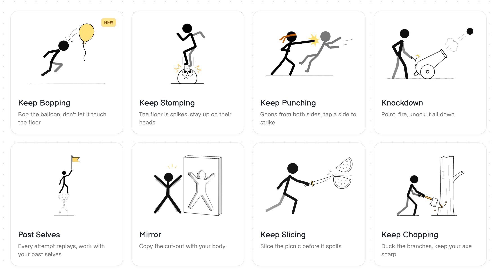
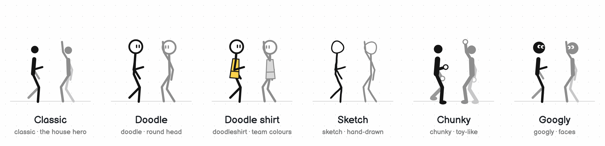

# goofyfish

[](https://goofyfish.com)
[](https://claude.com/claude-code)
[](./LICENSE)

Small, silly games for the browser. One input, one stick figure, a few seconds to learn, no install.

<a href="https://goofyfish.com"></a>

[](https://goofyfish.com)
[](https://goofyfish.com/make)

## Make your own game

You need [Claude Code](https://claude.com/claude-code), Node and pnpm.

```sh
git clone https://github.com/nilbuild/goofyfish
cd goofyfish && pnpm install
claude
```

Then describe your idea:

```
make a goofyfish game where you keep a balloon in the air
```

Claude builds it in the house style, tests it and draws its thumbnail. It asks which stick figure style you want:



Classic is the house hero. Doodle, Doodle shirt, Sketch, Chunky (toy-like) and Googly (faces) all use the same poses, so any game can use any of them. Name one in your idea (`a doodle shirt game where...`) or pick when asked. Play it, ask for changes, and when you're happy say so. It opens the pull request for you, and once it's merged your game is on the site.

What makes a goofyfish game:

- One input: tap, hold, swipe, or aim and let go.
- A stick figure doing one physical thing.
- Playing in 3 seconds, a run lasts under 3 minutes.
- Fun for a 6-year-old and a 40-year-old.

Found a bug or have an idea? [Open an issue](https://github.com/nilbuild/goofyfish/issues/new).

## License

[MIT](./LICENSE) © [Kamran Ahmed](https://x.com/kamrify)
